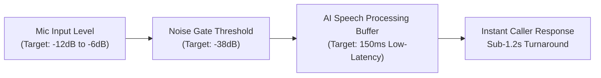

The crown jewel of *Scam With Your Friends* is its real-time conversational AI system. Callers do not rely on static branching dialogue trees; they actively listen to your vocal tone, pitch, pacing, and keywords through your real-world microphone.

A poorly configured microphone results in misheard keywords, accidental background noise pickup, or unbearable 4-second latency before the AI responds. Follow this optimization checklist to ensure buttery-smooth conversational flow.

---

## 1. Push-to-Talk (PTT) vs Voice Activity Detection (VAD)

While Voice Activity Detection feels natural, **Push-to-Talk is mandatory for co-op play**:

* **Why VAD Fails in Co-op**: If your co-op buddy screams *"The boss is coming!"* or laughs across Discord, an open microphone transmits that audio directly to your victim. The caller will perceive multiple voices, causing their Suspicion meter to jump by +35%.
* **Recommended Keybind**: Bind Push-to-Talk to a mouse side button (`Mouse 4` or `Mouse 5`), or your keyboard `Caps Lock` key.
* **Release Delay**: Set the game's PTT Release Delay to **250ms**. This ensures the tail end of your sentences isn't clipped before the AI finishes transcribing.

---

## 2. Calibrating the In-Game Noise Gate

Open the *Audio & Input* settings menu in Kolkata OS and adjust these three sliders:

1. **Input Sensitivity**: Speak in your normal conversational tone. The green audio bar should bounce comfortably between -12dB and -6dB. If it peaks into the red, lower your OS gain to eliminate harsh clipping.
2. **Noise Suppression**: Keep the AI Background Filter enabled. It filters out mechanical keyboard clicks (crucial when typing rapidly during CMD commands).
3. **AI Latency Preset**: Under *Advanced Audio*, select **"Fast Inference (Cloud Stream)"** if you have a stable broadband connection. This cuts the AI's thinking pause from 2.8 seconds down to 0.9 seconds!

---

## 3. Accent Tuning & Keyword Clarity

The game's speech recognition engine is tuned to identify core psychological pressure words. Emphasize these trigger words clearly:

- **Urgency Triggers**: *"Immediately"*, *"Arrest Warrant"*, *"Federal Marshal"*, *"Expired License"*.
- **Tech Triggers**: *"AnyDesk"*, *"UltraConnect"*, *"TeamViewer"*, *"Event Viewer"*, *"Trojan"*.
- **Financial Triggers**: *"Google Play"*, *"Target Card"*, *"Wire Transfer"*, *"Overpayment Refund"*.

> **Clear Enunciation**: If the AI mishears you saying *"Apple Card"* as *"Apple Cart"*, the caller will ask confused questions about fruit, resetting your pitch progress!

---

## 4. Text-Chat Fallback Mode

If you play late at night or don't have a functional microphone, enable **Text-Chat Mode** in the gameplay options:

* An in-game chat box docks below your SIP phone.
* Press `Enter` to type custom responses or use number keys `1-4` to fire pre-written quick-dialogue macros.
* Text mode provides 100% keyword accuracy, but callers receive a slight -10% charisma modifier compared to live voice acting.
