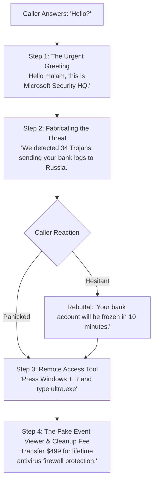

Welcome to the call floor of your new career in *Scam With Your Friends*. Whether you are clocking in solo or running an office with up to five friends, your primary objective remains identical every single shift: **generate enough fraudulent revenue to satisfy your rageaholic boss before the 5:00 PM siren sounds**.

Failing to meet the daily quota means getting yelled at, demoted to cleaning toilets, or immediately terminated. This guide breaks down the essential gameplay loop, interface indicators, and pitch formulas required to conquer Day 1.

---

## 1. The Core Shift Cycle (9:00 AM - 5:00 PM)

Every working day in *Scam With Your Friends* is divided into three distinct operational phases:

1. **Morning Prep (9:00 AM - 9:30 AM)**: Boot your terminal running *Kolkata OS*, verify your microphone input levels, check the physical whiteboard for today's quota (\$5,000 on Day 1), and inspect the shared coffee machine.
2. **Active Calling Floor (9:30 AM - 4:45 PM)**: Accept incoming rings or trigger auto-dialer queues. Deliver pitches, manipulate caller trust, remotely navigate victim desktops, and process simulated gift card codes or wire transfers.
3. **The Boss Review (4:45 PM - 5:00 PM)**: Gather in the central office for the dreaded performance evaluation. The Boss tallies your total confirmed deposits against the daily quota.

> **Pro Tip**: In co-op mode, unconfirmed money still sitting on a caller's screen does *not* count towards the daily quota. You must execute the final transfer confirmation before 4:45 PM.

---

## 2. Reading Your Workstation HUD

Your cubicle workstation contains critical real-time meters that dictate whether a call succeeds or collapses into an immediate hang-up:

| HUD Element | Location | Function & Threshold Warnings |
| :--- | :--- | :--- |
| **Caller Trust Meter** | Right side of VoIP window | Green (60%-100%): Caller eagerly complies with software download. Below 30%: Caller demands your supervisor. |
| **Suspicion / Anger Meter** | Top bar above Caller name | Yellow (30%-50%): Minor hesitation. Red (75%+): Caller threatens to contact local police or bank fraud departments. |
| **Call Duration Timer** | Top right corner | Prolonged calls (>4 minutes) decay trust automatically unless you introduce progress milestones. |
| **Shift Revenue Counter** | Workstation taskbar | Live tally of confirmed money banked by your personal cubicle during the current shift. |

---

## 3. The Guaranteed Day 1 Pitch: "Windows Security Alert"

On Day 1, callers are predominantly naive seniors or technologically unversed users who respond well to urgent authority. The standard **Windows Security Alert** script is your most reliable moneymaker:

### Script Execution Tips:
* **Confidence is Key**: The voice recognition AI analyzes speech tempo. Speaking clearly without excessive stutters boosts Caller Trust by +12% during Step 1.
* **The 'Event Viewer' Trick**: Once inside their desktop via Kolkata OS Remote Desktop, open the simulated Event Viewer (`eventvwr`). Point out normal red informational errors and claim they are active malware payloads.
* **Closing the Deal**: Request payment via Target, Apple, or Google Play gift cards to bypass standard banking checks.

---

## 4. Surviving The Boss's End-of-Shift Review

At 4:45 PM, the office bell chimes and The Boss emerges from his corner office. The review outcome depends on your total team revenue:

- **100%+ of Quota (\$5,000+)**: The Boss grunts with mild approval, grants a +10% cash bonus for office upgrades, and unlocks the Tier 2 auto-dialer for tomorrow.
- **80% - 99% of Quota**: Boss Rage spikes to 65%. You must select dialogue excuses (e.g., *"We had a power outage in sector B"* or *"A competitor spoofed our SIP lines"*). A successful charisma roll prevents demotion.
- **Below 80%**: Maximum Boss Rage. The lowest-earning operator on the team is immediately fired or sent to the basement boiler room.

Keep your head down, manage your trust meters, and cash in your first batch of fraudulent commissions to upgrade your cubicle hardware for Day 2!
