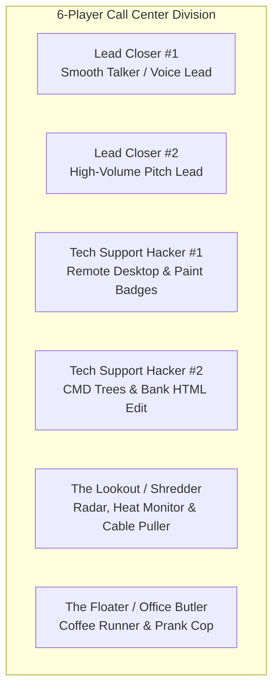

While solo play is a tense test of multitasking, *Scam With Your Friends* achieves its peak comedy and efficiency when played with a full squad of six operators.

A disorganized office of six people quickly descends into fire alarms, shredded paychecks, and screaming matches with The Boss. An organized team, however, operates like an unstoppable fraudulent syndicate. Here is the established 6-player role meta.

---

## 1. The Optimal 6-Player Squad Roster

Assign players to these four defined operational roles before clocking into the shift:

### Role Breakdown:
1. **The Lead Closers (2 Players)**: Focus 100% on verbal persuasion. They handle active phone lines, manipulate caller trust, and deliver the emotional pitch. They never touch remote software tools themselves; they simply keep the victim talking while passing the six-digit remote code to the Hackers.
2. **The Tech Hackers (2 Players)**: The hands on the keyboard. They receive UltraConnect codes from Closers, remotely access the victim's machine, run fake virus scans, edit bank balances via Inspect Element, and generate forged IRS badges in Paint.
3. **The Lookout / Shredder (1 Player)**: Stations themselves near the central whiteboard and radar console. Monitors office Heat Level, spots police cars through the blinds, and stands ready to pull router plugs and operate the industrial shredder.
4. **The Floater / Coffee Runner (1 Player)**: Keeps team stamina high by brewing pots of coffee and delivering cups directly to active Closers. Cleans up spilled drinks, extinguishes minor server flare-ups, and handles physical mail drops.

---

## 2. The "Double-Team Transfer" Technique

When an elderly target or high-wealth business owner demands to speak with a superior, use the **Double-Team Transfer**:

1. **Closer #1**: *"Ma'am, because the malware is so severe, I must escalate you to my Senior Federal Supervisor."*
2. Closer #1 puts the call on brief hold (`F3`), queuing an elevator music jingle.
3. **Closer #2** picks up the line with a deeper, stern vocal tone: *"Hello, this is Senior Director Harrison, Federal Security Level 5."*
4. **Psychological Impact**: Callers perceive multi-department authority. Caller Trust instantly surges by +25%, allowing the team to demand \$3,000 instead of \$500!

---

## 3. Communication Protocols: Avoiding Cross-Talk

With six people shouting into microphones in the same virtual room, cross-talk will ruin calls:

* **Sit in Alternating Cubicles**: Do not place two active Lead Closers in adjacent cubicles. The game simulates spatial sound propagation; loud shouting will bleed into a neighbor's microphone.
* **Whisper Mode (`Z Key`)**: Allows Hackers and Closers to whisper private coordinates without alerting the caller on the phone.
* **The Breakroom Rule**: Teammates who are not on active calls should hang out in the breakroom playing darts or making coffee to keep the main floor quiet.

Master the squad synergy, divide and conquer the dialer queues, and watch your daily team revenue soar past \$30,000!
