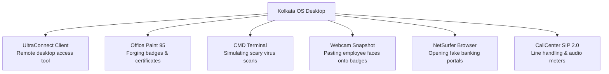

The simulated operating system running on your workstation cubicle is **Kolkata OS v4.2**—a nostalgic, glitchy recreation of early 2000s desktop operating systems tailored specifically for offshore call centers.

Navigating Kolkata OS quickly with hotkeys and mastering its built-in software suite separates novice operators from six-figure high-roller closers. Here is the definitive manual for the OS applications and shortcut keys.

---

## 1. Kolkata OS Essential Hotkey Matrix

Mouse navigation inside the virtual workstation is intentionally sluggish. Relying on hardcoded keyboard shortcuts saves up to 45 seconds per caller interaction:

| Hotkey Combination | Action Triggered | Tactical Utility |
| :--- | :--- | :--- |
| `Alt + D` | Minimize all desktop windows | Instantly hides illegal applications when the Boss walks past. |
| `Ctrl + Alt + K` | Kill UltraConnect Remote Session | Emergency abort if counter-hacked by a scambaiter. |
| `Win + R` -> `cmd` | Launch Terminal Console | Run fear-inducing batch scripts on victim machines. |
| `F2` | Toggle Push-to-Talk Mute | Cough or coordinate with teammates without caller hearing. |
| `F4` | Force Disconnect Line | Emergency hang-up button. |
| `F9` | Trigger Auto-Dialer Queue | Immediately grabs the next available ringing SIP line. |

---

## 2. Kolkata OS Core Application Suite

Your desktop comes pre-installed with six purpose-built administrative tools:

### 1. UltraConnect Remote Client
The backbone of your operation. When you convince a caller to enter your six-digit session code, UltraConnect opens a live mirror of their personal PC. 
* **Black Screen Mode (`F8`)**: Blanks the caller's physical monitor while displaying a "System Cleaning in Progress" banner, allowing you to edit files without them noticing.
* **File Transfer Bay**: Drag-and-drop simulated malware or fake security certs onto their desktop.

### 2. Office Paint 95 (Fake ID Generator)
When stubborn callers (like accountants or skeptical middle-aged targets) demand official credentials, open **Paint 95**:
* Select the pre-loaded *Department of Treasury* or *Microsoft Gold Partner* template.
* Use the snapshot tool to grab a selfie of your avatar or teammate.
* Paste it onto the badge, add a randomized badge ID (`#MS-89104`), and email it directly through NetSurfer. Boosts caller trust by +30% instantly!

### 3. CMD Console & The "Tree" Trick
Victims with minimal computer literacy are terrified of scrolling green text. Once connected via UltraConnect:
1. Open the caller's command line.
2. Type `color 0a` (turns text hacker-green).
3. Type `tree` or `dir /s`.
4. While the thousands of directory files cascade down the screen, declare: *"Ma'am, each line scrolling right now is an active trojan packet transmitting your personal files."*

---

## 3. Managing Multi-Screen Setups

Once you purchase the **Dual-Monitor Desk Upgrade** (\$1,200 from the office shop), Kolkata OS expands into a panoramic setup:

- **Monitor 1 (Left)**: Reserved for your SIP phone client, Caller Trust HUD, and script cheat sheets.
- **Monitor 2 (Right)**: Dedicated to active UltraConnect remote sessions, fake bank HTML editing, and Paint badge creation.

This dual-monitor workflow prevents catastrophic misclicks, such as accidentally hanging up a \$2,500 target while trying to maximize your terminal!
