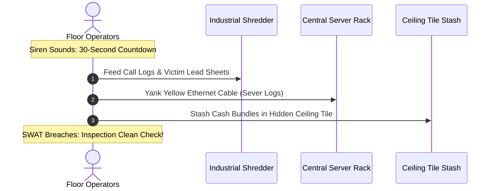

Operating an illegal offshore call center comes with occupational hazards far beyond customer service complaints. In *Scam With Your Friends*, dynamic office disasters occur randomly during high-heat shifts.

A single mishandled emergency can lead to team-wide arrest, seized assets, or permanent workstation destruction. This guide outlines the survival protocols for police raids, server room infernos, and rampant ransomware attacks.

---

## 1. The 30-Second Police Raid Protocol

When your office's **Heat Level** reaches 100% (caused by lingering scambaiters, IRS impersonation complaints, or excessive high-value wire transfers), flashing red lights illuminate the floor and the roof siren shrieks.

You have exactly **30 seconds** before SWAT breaches the front doors:

### Essential Evacuation Checklist:
1. **Feed the Industrial Shredder (Priority 1)**: Grab physical printed call sheets, Target gift card receipt slips, and phone directories from desktops and feed them into the shredder next to the breakroom. Every un-shredded document found by inspectors adds a \$500 team fine.
2. **Yank the Server Cables (Priority 2)**: Sprint to the central server rack and hold `E` to pull the master blue/yellow Ethernet lines. This wipes active SIP call traces and prevents remote forensic recovery.
3. **Hide the Cash in Ceiling Tiles (Priority 3)**: Unbanked physical cash rolls sitting on desks will be confiscated. Jump on an office chair, open the loose ceiling tile, and stash the money bags inside.
4. **Assume Innocent Sitting Positions**: Before the timer hits 0:00, all players must be seated in their desk chairs with benign Kolkata OS windows (e.g., standard spreadsheet or calculator) displayed on their monitors.

Passing the inspection results in the police issuing a minor noise complaint fine (\$200) instead of shutting down the entire operation!

---

## 2. Electrical Fires & Extinguisher Relay

During intense calling hours when multiple auto-dialers are running simultaneously, server racks and cheap coffee pots frequently catch fire:

* **Spreading Fire Mechanic**: Unchecked flames destroy nearby cubicle desks, permanently disabling computers for the remainder of the shift.
* **Fire Extinguisher Locations**: Two red fire extinguishers are mounted on the east and west corridor walls.
* **Tackling the Blaze**: Pick up the canister (`E`), aim the nozzle at the base of the fire (`Right Click + Left Click`), and sweep back and forth.
* **Smoke Inhalation Debuff**: Standing in thick smoke causes operators to cough uncontrollably, immediately alerting callers on the phone and dropping Caller Trust by 40%.

---

## 3. Workplace Pranks & Sabotage Management

In co-op mode, bored teammates can weaponize office equipment against each other:

| Prank / Sabotage Item | How to Deploy | Counter-Measure |
| :--- | :--- | :--- |
| **Sticky Note Blindfold** | Stick yellow notes directly onto a teammate's monitor. | Press `F` to tear off notes one by one. |
| **Hot Coffee Throw** | Splash fresh coffee on an operator's keyboard. | Wipes keyboard with a paper towel; causes 10s typo lag. |
| **Air Horn Blast** | Fire a handheld horn directly into an operator's microphone. | Instantly deafens teammate and hangs up their active call. |
| **Office Chair Wheelie** | Kick a teammate's rolling chair across the floor. | Roll back to your desk before the caller hangs up. |

Keep office chaos contained, stay alert during red siren events, and safeguard the team's ill-gotten gains!
