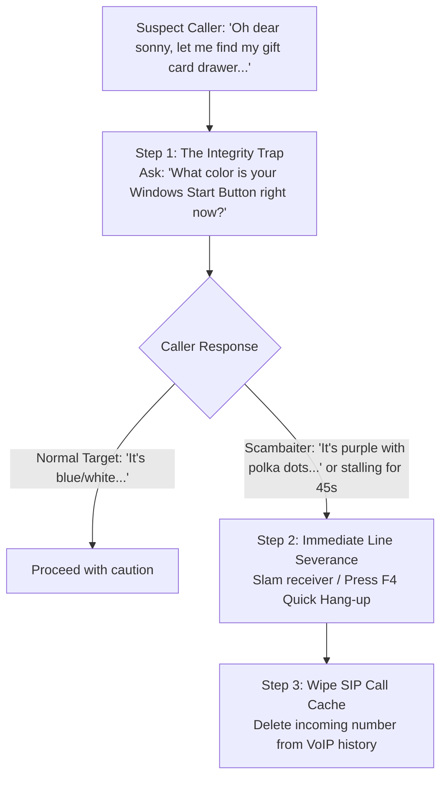

In *Scam With Your Friends*, not every voice on the other end of the line is a helpless target. The developers have baked in sophisticated AI-driven **Scambaiters**—inspired by legendary anti-scam creators like *Jim Browning, Kitboga, and Pierogi*.

Taking the bait can wipe out your entire shift's earnings, crash your local Kolkata OS desktop, or summon an instant police raid. This guide teaches you how to identify scambaiters within the first 30 seconds of a call and execute the correct severance protocols.

---

## 1. Recognizing Scambaiter Red Flags

Scambaiters masquerade as gullible seniors or distracted office workers, but subtle auditory and behavioral clues reveal their true identity:

| Suspicious Indicator | Subtle In-Game Clue | Threat Level |
| :--- | :--- | :--- |
| **Voice Pitch Modulation** | Synthetic elderly voice with robotic frequency wobble (Kitboga's 'Edna' parody). | **High**: Intentional time-sink. |
| **Hyper-Specific Tech Questions** | Asks for your IP address, server port, or claims their router has a 'Level 4 token'. | **Critical**: Probe for counter-attack. |
| **Unnatural Willingness to Pay** | Instantly agrees to send \$10,000 without questioning why Microsoft needs gift cards. | **High**: Fake bank interface trap. |
| **Virtual Machine Sound Effects** | Subtle Windows 98 boot chords or echo chamber mouse clicks in their background audio. | **Critical**: Sandboxed honey pot. |

---

## 2. What Happens If You Fall Into the Trap?

Connecting via Kolkata OS Remote Access to a scambaiter's machine triggers automated counter-measures designed to ruin your shift:

1. **The Honey Pot Fake Bank**: They open a browser showing \$250,000 in savings. When you attempt to edit the HTML element via Inspect Element, the web page inverts your monitor's colors and deploys a desktop Trojan to your workstation.
2. **Reverse SysKey Lockout**: The scambaiter hijacks your remote connection to lock your Kolkata OS desktop with an encrypted password. Your workstation becomes unusable for 3 minutes unless an ally uses a physical USB recovery stick.
3. **Audio Blast Soundboard**: The caller suddenly swaps their gentle voice for deafening air horns, startling your operator and triggering a 50% temporary hearing impairment debuff.
4. **SIP Carrier Reporting**: Staying on the line for more than 3 minutes with a confirmed scambaiter increases the **Police Raid Probability** meter by +35%.

---

## 3. The 3-Step Rebuttal & Severance Protocol

When you suspect an undercover scambaiter, follow this exact sequence:

### Why Quick Hang-up Matters:
A standard hang-up on a real customer incurs a minor -5% team morale penalty from The Boss. However, hanging up on a confirmed Scambaiter within the first 60 seconds awards a **"Street Smart Operative"** bonus, earning +200 bonus XP for your operator tree!

---

## 4. Workstation Recovery If Counter-Hacked

If your computer screen suddenly turns inverted or starts spamming popup error dialogs:

* **Step 1**: Immediately press `Ctrl + Alt + K` to kill the Kolkata OS Remote Host service.
* **Step 2**: Grab the yellow fire extinguisher or anti-virus floppy disk located next to the water cooler.
* **Step 3**: Insert the disk into your drive bay and hold the clean button for 5 seconds to purge the malware payload.

Never let a scambaiter hold your line hostage. In this business, lost time equals an enraged boss!
