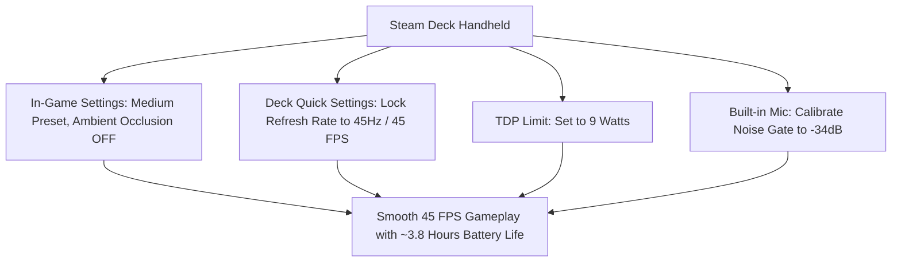

*Scam With Your Friends* pairs retro office simulation aesthetics with cutting-edge real-time cloud AI speech processing. While the graphics engine runs effortlessly on modest GPUs, real-time voice recognition and VoIP streaming require stable internet throughput and decent CPU multitasking.

Here are the officially verified PC specifications, Steam Deck optimization presets, and network bandwidth thresholds.

---

## 1. Official PC System Specifications

| Hardware Component | Minimum Requirement (1080p 30 FPS) | Recommended Spec (1080p 60 FPS) |
| :--- | :--- | :--- |
| **Operating System** | Windows 10 (64-bit) | Windows 10/11 (64-bit) |
| **Processor (CPU)** | Intel Core i3-6100 / AMD Ryzen 3 1200 | Intel Core i5-9400 / AMD Ryzen 5 3600 |
| **Memory (RAM)** | 8 GB RAM | 16 GB Dual-Channel RAM |
| **Graphics (GPU)** | NVIDIA GeForce GTX 960 (4GB) / AMD Radeon RX 560 | NVIDIA GeForce GTX 1660 Super / AMD Radeon RX 5600 XT |
| **Storage** | 6 GB available SSD space | 6 GB NVMe SSD space |
| **DirectX** | Version 11 | Version 12 |
| **Audio Hardware** | Standard USB Headset with Microphone | Dedicated Cardioid Microphone with Noise Gate |
| **Network** | Broadband connection (10 Mbps down / 2 Mbps up) | Stable fiber connection (50+ Mbps with <50ms ping) |

---

## 2. Steam Deck Optimization Profile (45 FPS Golden Ratio)

*Scam With Your Friends* is fully playable on the Steam Deck, featuring complete controller remapping and seamless built-in microphone pickup:

### Handheld Tips:
- **Trackpad Navigation**: Set the Right Trackpad to *As Mouse* and Left Trackpad to *Radial Menu* for instant Kolkata OS shortcuts (`F2`, `F4`, `F8`, `F9`).
- **Deck Microphone**: The Steam Deck's dual array microphones perform surprisingly well, but avoid resting your palms over the top grille to maintain crisp vocal clarity.

---

## 3. Network & Voice AI Latency Benchmarks

The conversation engine operates over encrypted cloud endpoints:

- **Bandwidth Consumption**: Approximately 35 MB per 15-minute game shift per connected player.
- **Packet Loss Sensitivity**: Packet loss above 3% causes stuttered voice transmission, leading the AI caller to misinterpret your words or ask *"Can you repeat that?"*
- **Ping to Cloud Servers**: Ping under 60ms delivers instantaneous 0.9s response intervals. Ping over 180ms increases AI response time to ~2.5 seconds.
