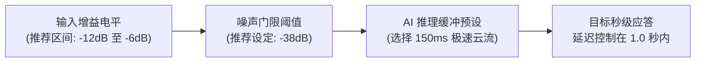

《Scam With Your Friends》最惊艳的核心特色莫过于其**实时大模型语音对话 AI**。受害者不再依赖枯燥的死板对话选项分支，而是通过你真实的麦克风实时倾听你的语调、音调高低、说话节奏与关键词。

若麦克风配置不当，极易导致关键词识别错误、背景杂音误触发、或是每次说话后 AI 目标迟钝 4 秒才作答的尴尬局面。请遵循以下调优手册进行设置。

---

## 一、 按键说话 (PTT) vs 自由麦拾音 (VAD)

虽然开黑时自由麦最省事，但**联机模式下必须强制使用一键按键通话 (Push-to-Talk)**：

* **为什么自由麦会导致团灭**：如果队友在旁边大喊“卧槽老板来了快跑”或者在 Discord 哈哈大笑，自由麦会将声音全部广播给受害者。电话那头会敏锐察觉到有多人在场，怀疑度仪表盘将瞬间暴涨 +35%。
* **推荐按键绑定**：绑定在鼠标侧键 (`Mouse 4` 或 `Mouse 5`)，或者键盘上的 `Caps Lock` 键。
* **按键松开缓冲延迟**：在游戏设置中将 PTT Release Delay 设定为 **250ms**，防止一句话最后一个字还没说完就断音。

---

## 二、 工位噪声门限精准校准

在 Kolkata OS 的音频设置界面中，微调以下三项关键参数：

1. **输入灵敏度**：用正常说话语气测试，音量绿条应当在 -12dB 至 -6dB 之间跳动。如果频繁亮红灯爆音，请在 Windows 声音面板中调小麦克风硬件增益。
2. **AI 背景降噪**：务必勾选“AI Background Noise Filter”。它能精准过滤机械键盘敲击声（在敲击 CMD 代码时极为关键）。
3. **推理延迟模式**：在高级选项中选择 **“Fast Inference (Cloud Stream)”**。只要网络稳定，可将 AI 的思考停顿从 2.8 秒大幅缩短至 0.9 秒！

---

## 三、 核心压力关键词与发音清晰度

游戏的语音转文字引擎针对灰产心理学核心词汇做了高权重适配。在说话时请加重这些词汇的发音：

- **紧急施压类**：*“立刻 (Immediately)”*、*“逮捕令 (Arrest Warrant)”*、*“联邦警长 (Federal Marshal)”*、*“账户冻结 (Account Frozen)”*。
- **技术操作类**：*“远程协助 (AnyDesk / UltraConnect)”*、*“事件查看器 (Event Viewer)”*、*“严重木马 (Trojan Virus)”*。
- **收尾支付类**：*“Google Play 礼品卡”*、*“Target 实体卡”*、*“紧急电汇 (Wire Transfer)”*。

> **发音避坑**：如果你将 “Apple Gift Card” 念得含糊不清，AI 可能会误识别为水果，导致老太太疑惑反问，直接重置前序累积的信任值！

---

## 四、 纯打字模式 (Text Fallback Mode)

如果你在深夜不便开麦，或硬件设备临时故障，可以在选项中开启**文本辅助打字模式**：

* VoIP 电话下方会悬浮输入框。
* 按 `Enter` 键即可输入自由文本，或按数字键 `1-4` 触发常用预设话术宏。
* 打字模式的关键词识别率高达 100%，但相比真实语音带有轻微的 -10% 魅力加成惩罚。
