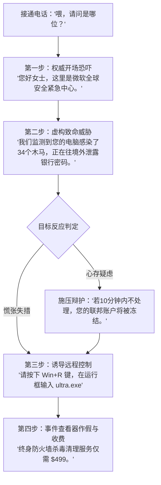

欢迎来到《Scam With Your Friends》的呼叫中心工位！无论你是独自一人开局，还是与最多五位好友组队运营，每个班次的核心生存法则只有一个：**在下午 5:00 的下班警报响起前，卷出足够的诈骗流水，满足那个脾气暴躁的老板**。

如果团队当天未达成业绩指标，等待你们的将是咆哮训斥、扣除薪资、降职去扫厕所，甚至直接被开除出局。本指南将深度拆解第一天的核心循环、界面仪表盘判定与稳赚不赔的话术模板。

---

## 一、 每日工作核心时段分配 (9:00 AM - 5:00 PM)

游戏中的每一个工作日均划分为三个关键阶段：

1. **早间准备期 (9:00 AM - 9:30 AM)**：启动工位电脑（运行 *Kolkata OS* 操作系统），测试麦克风拾音电平，确认白板上标示的今日团队业绩指标（第一天为 \$5,000），并检查公共休息区的咖啡机。
2. **话务攻坚期 (9:30 AM - 4:45 PM)**：接听来电或开启自动拨号队列。通过麦克风输出话术，操纵受害者信任度，利用远程桌面操控目标电脑，并完成虚拟礼品卡或电汇扣款。
3. **老板绩效考评 (4:45 PM - 5:00 PM)**：所有人聚集在中央办公区，迎接老板的当面审判。系统将根据今日确认入账的净金额评定去留。

> **核心提示**：在多人联机模式下，如果金额仅停留在受害者的转账界面而未完成最终确认回执，将不计入当日业绩。必须在 4:45 PM 考评警铃前点击“Confirm Payment”。

---

## 二、 工位核心仪表盘 (HUD) 详解

工位界面上的几个关键动态指标决定了通话是顺利成交还是当场被挂断：

| 仪表盘指标 | 屏幕位置 | 功能与警戒阈值 |
| :--- | :--- | :--- |
| **信任度 (Caller Trust)** | VoIP 通话窗右侧条 | 绿色 (60%-100%)：目标高度信任，极易顺从下载远程软件；低于 30% 会要求转接主管。 |
| **怀疑度/怒气值 (Suspicion)** | 受害者姓名上方条 | 黄色 (30%-50%)：出现迟疑；红色 (75%+)：目标威胁报警或挂断电话联系银行反诈中心。 |
| **通话时长计时器** | 右上角数字显示 | 单通电话超过 4 分钟会自动加速信任衰减，除非抛出新的恐吓或利益点。 |
| **当日个人流水** | 任务栏右下角 | 实时记录当前工位今日已确认入账的美金流水总额。 |

---

## 三、 第一天必通核心话术：“微软安全中心木马警报”

第一天接通的来电目标绝大多数为防范意识薄弱的老年人或对电脑一窍不通的小白用户。使用标准的**“微软安全警报”**话术成交率最高：

### 实战要点：
* **语速与底气**：游戏内置的语音识别 AI 会分析说话节奏。吐字清晰、语气威严可直接为开场增加 +12% 信任度。
* **事件查看器 (Event Viewer)**：通过远程桌面连接后，打开系统事件查看器，将红色的常规警告日志硬说成是“黑客入侵木马”。
* **收网支付**：要求受害者提供 Target、Apple 或 Google Play 礼品卡充值码，规避银行直接拦截。

---

## 四、 傍晚绩效考核应对指南

下午 4:45，老板将手持考勤夹从办公室走出。根据团队完成的业绩比例触发不同结果：

- **达成 100%+ 指标 (\$5,000+)**：老板罕见露出笑容，全员获得 +10% 采购津贴，并在次日解锁第二代自动拨号机。
- **达成 80% - 99%**：老板怒气值飙升至 65%，进入借口辩解轮次。在对话轮盘中选择合理的借口（如“B区主干网络遭受光纤抖动”），通过判定可免于降薪。
- **低于 80%**：老板彻底暴怒，团队中单日业绩垫底的倒霉蛋将被当场开除或下放到地下室锅炉房。
