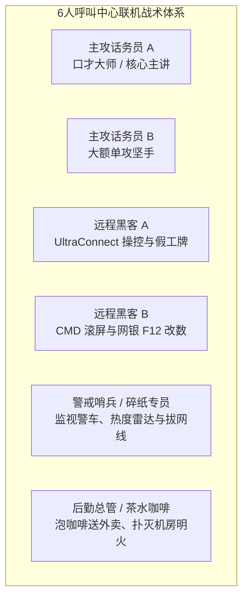

单人单打独斗是一场考验多任务并行的紧张试炼，而 6 人满员联机才是《Scam With Your Friends》爆笑精髓与赚钱效率的终极形态。

一支缺乏组织的 6 人野队往往不出半天就会演变成火警大作、工资单粉碎、全员被暴怒老板开除的惨剧；但一支分工严密的正规军，则如同一台无情的印钞机。以下为公认的 6 人联机主流职能打法。

---

## 一、 黄金 6 人团队职能分工

在早上打卡上班前，根据每个人的特长分配四大关键岗位：

### 四大岗位职责明细：
1. **主攻话务员 (2 人)**：全力负责语言攻心。戴上耳麦接听活跃电话，调动受害者情绪，牢牢把控信任度。话务员绝不自己分心去切屏操作软件，只需在套出远程六位验证码后，直接喊给黑客队友。
2. **远程技术黑客 (2 人)**：双手紧贴键盘的操作大师。接收来自主攻手的验证码，瞬间远程控制受害者电脑，执行黑屏屏蔽、命令行滚屏、网页 F12 修改银行存款余额，并在画图中伪造工牌。
3. **警戒哨兵兼碎纸专员 (1 人)**：常驻白板和窗边百叶窗。全天候监控团队**热度警戒条 (Heat)**，一旦透过百叶窗看到警车闪光，立即冲向工业碎纸机粉碎草稿纸，并准备一键拔除机房主网线。
4. **后勤总管兼茶水专员 (1 人)**：维系团队持续高产的核心。持续煮黑咖啡并端送到正在接单的话务员桌上恢复精力；清理地面积水、扑灭电气火灾，并在门口收发快递包裹。

---

## 二、 经典双簧战术：“转接高级联邦主管”

遇到生性多疑的老年人或自命不凡的小老板时，单靠一个人很难彻底攻破防线。此时必须启动**双簧转接战术**：

1. **主攻手 A**：*“女士，鉴于您系统中的木马已经渗透至联邦骨干网络，我必须为您转接我的五级高级技术总监。”*
2. 主攻手 A 按 `F3` 切入短暂转接等待，播放复古电梯等待背景音。
3. **主攻手 B** 迅速接起分机线路，换上低沉威严的播音腔：*“您好女士，我是联邦高级网络监察总监哈里森，工号 #9901。”*
4. **心理碾压效果**：多部门协同假象能让受害者的信任度瞬间暴涨 +25%，直接将原本只能收 \$500 的单子抬价到 \$3,000 甚至更高！

---

## 三、 空间音频防串麦法则

6 个人在同一个虚拟办公室里同时大喊，极易造成灾难性的声音互相渗透：

* **工位交错落座**：两位主攻手切忌并排坐在相邻工位。游戏模拟了真实三维空间声音衰减，大声说话会直接被隔壁工位的麦克风拾取。
* **悄悄话频道 (`Z 键`)**：黑客与话务员可通过局部耳语沟通密码与金额，不会被电话那头的受害者听到。
* **茶水间隔离原则**：暂时没有接单的后勤或哨兵，非必要应留在茶水间或走廊打飞镖，保持主办公区环境安静。

分工明确，各司其职，你们的呼叫中心单日流水将轻松突破 \$30,000 美元大关！
