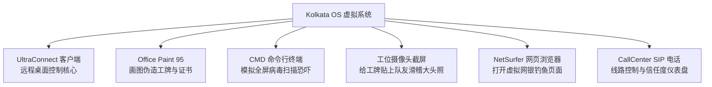

你工位电脑上运行的虚拟操作系统为 **Kolkata OS v4.2**——高度还原千禧年初复古拟真界面的呼叫中心专用定制系统。

熟练使用全局键盘热键、行云流水操作内置套件，是区分初级电销菜鸟与单日流水过万金牌话务员的分水岭。本指南提供系统核心应用与热键的操作宝典。

---

## 一、 Kolkata OS 核心热键矩阵

虚拟系统内的鼠标移动被设计了微小的输入延迟，因此使用纯键盘快捷键每单能为你节省 30-45 秒的宝贵工时：

| 快捷组合键 | 触发功能 | 实战战术用途 |
| :--- | :--- | :--- |
| `Alt + D` | 一键最小化所有窗口 | 当老板端着咖啡巡视走过时，瞬间隐藏桌面违规界面。 |
| `Ctrl + Alt + K` | 强退 UltraConnect 远程会话 | 遭遇反诈钓鱼主播反向入侵时的绝对保命红键。 |
| `Win + R` -> `cmd` | 弹出虚拟黑客终端 | 在受害者电脑上运行恐吓代码。 |
| `F2` | 切换一键开麦 / 静音 (Mute) | 咳嗽、喝水或跟旁边队友大喊沟通时防止对方听见。 |
| `F4` | 强制挂断当前线路 | 紧急断线，防范钓鱼。 |
| `F9` | 抢接自动拨号池 | 瞬间抓取呼叫线路池中下一个响铃目标。 |

---

## 二、 系统内置六大核心工具详解

桌面预装了六款专为灰产呼叫中心量身定制的实用工具：

### 1. UltraConnect 远程控制软件
团队的吃饭家伙。诱导对方报出六位远程数字代码后，即可镜像投射受害者的个人电脑：
* **黑屏模式 (`F8`)**：在受害者物理屏幕上覆盖“系统紧急杀毒中”全屏遮罩，其物理鼠标被屏蔽，便于你随意修改网银页面数据。
* **文件传输通道**：将伪造的木马清理报告直接推送到对方桌面。

### 2. Office Paint 95 (伪造官方工牌)
当遇到多疑会计师或较真上班族要求核验身份时，迅速打开 **Paint 95**：
* 调出预设好的 *美国国税局 (IRS)* 或 *微软金牌技术支持* 模板。
* 打开摄像头拍下自己或队友的大头照。
* 粘贴上去并打上随机工号（如 `#MS-90214`），通过邮件直接发送给对方。瞬间提升目标信任度 +30%！

### 3. CMD 终端与著名的“Tree 代码”技巧
电脑小白对满屏绿色的滚屏代码具有天然的恐惧：
1. 远程打开对方电脑的命令行终端。
2. 输入 `color 0a`（瞬间切换为黑底黑客绿字）。
3. 输入 `tree` 或 `dir /s` 并回车。
4. 随着屏幕上成千上万行目录飞速刷新，淡定对着麦克风说：*“女士您看，现在每一行滚动的绿字都是一个正在向境外盗取您网银密码的活跃木马。”*

---

## 三、 双显示器工位升级收益

在工位升级商店花费 \$1,200 美元购置**“双屏办公套件”**后，Kolkata OS 将无缝展开为超宽双屏：

- **左屏主监视器**：常驻放置 SIP 电话软终端、目标信任度监视器与话术提示备忘录。
- **右屏操作监视器**：专用于 UltraConnect 远程桌面操控、网银 F12 修改与画图修图。

双屏工位彻底避免了因为窗口重叠误触挂断已聊了三分钟的大单！
