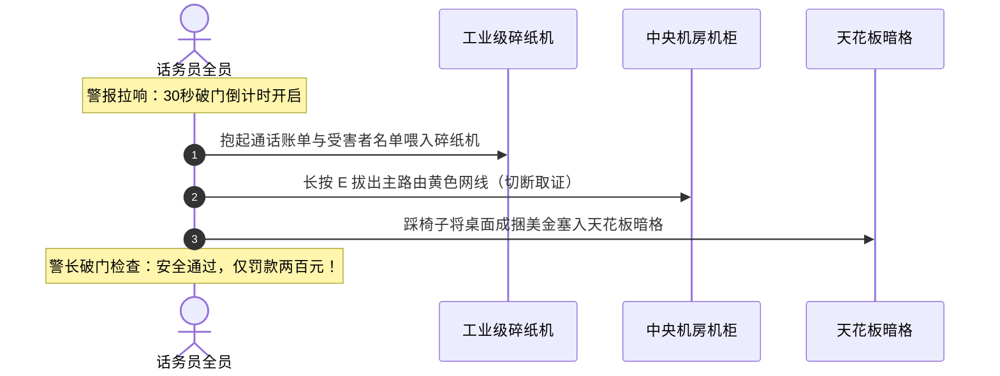

经营地下灰产呼叫中心面临的职业风险远超普通白领客服。在《Scam With Your Friends》中，高威胁等级的班次中会随机爆发毁灭性的突发办公室灾难。

一次处置不当的警车突袭就可能导致团队全员被捕、账面资金被连锅端，甚至整个工区被彻底查封。本规程总结了警车突袭破门、机房电气火灾与同事恶搞混乱的核心应急方案。

---

## 一、 30 秒警车破门突袭应急规程

当呼叫中心的**热度警戒条 (Heat Level)** 累积至 100%（通常由长期与反诈主播纠缠、过度使用国税局名义恐吓、或频繁大额转账触发）时，办公室天花板将红光闪烁，防空警报骤响。

此时全队拥有整整 **30 秒黄金倒计时** 应对特警破门：

### 紧急四步检查清单：
1. **工业碎纸机粉碎物证（最高优先级）**：抱起工位桌面上打印的受害者电话名单、苹果礼品卡卡密草稿纸，全部喂入茶水间旁的工业碎纸机。每留下一张未粉碎的纸张，警察搜查后将对团队处以 \$500 美元重罚。
2. **怒拔主干网线（第二优先级）**：奔向中央机房机柜，按住 `E` 键强行拔下闪烁的黄蓝网线。这将切断所有活跃 SIP 追踪，阻止执法人员现场提取远程连接日志。
3. **美金现钞藏匿天花板**：桌面上未存入银行的现金袋会被全额没收。跳上旋转办公椅，推开天花板上松动的隔音板，将现金袋塞入暗格藏好。
4. **假装无辜正常办公**：在倒计时归零前，所有玩家必须坐回各自工位，电脑屏幕切为 Excel 表格或计算器等无害窗口。

完美通过检查后，警方只会判定为“扰民噪音”，开出一张 \$200 的轻微罚单扬长而去！

---

## 二、 机房电气火灾扑救接力

在全员狂开自动拨号机、多线高负荷运转的午后高峰期，老旧电线和廉价咖啡壶极易短路起火：

* **火势蔓延机制**：无人扑灭的火苗会迅速引燃相邻工位隔板，直接烧毁电脑主机导致该工位全天报废。
* **灭火器位置**：东西两侧走廊墙壁上各挂有一具红色干粉灭火器。
* **灭火操作**：按 `E` 拎起灭火器，按住右键瞄准火苗根部，点击左键扫射扑灭。
* **浓烟咳嗽负面状态**：站在浓烟中会导致角色剧烈咳嗽，声音通过麦克风传给电话那头，导致受害者信任度瞬间暴跌 40%。

---

## 三、 办公室恶搞与混乱防范

在联机模式下，无聊的队友可能会把办公用品变成致命的恶搞武器：

| 恶搞道具 | 使用方式 | 化解与应对措施 |
| :--- | :--- | :--- |
| **便签纸蒙眼** | 将黄色便利贴直接贴在正在通话队友的显示器上。 | 狂按 `F` 键逐张撕下便利贴。 |
| **泼热咖啡** | 将滚烫的黑咖啡泼在队友的键盘上。 | 抽出纸巾擦拭，键盘会导致 10 秒输入粘滞。 |
| **高音气喇叭** | 拿着手持气喇叭对着正在说话队友的耳麦猛按。 | 瞬间震聋队友并直接挂断其当前通话。 |
| **办公椅漂移** | 飞起一脚把坐着队友的滚轮椅踹飞到走廊尽头。 | 赶紧滑动滚轮椅滑回电脑前，防止超时挂断。 |

保持办公室秩序，警惕红光警报，稳稳守住大家的辛苦血汗钱！
