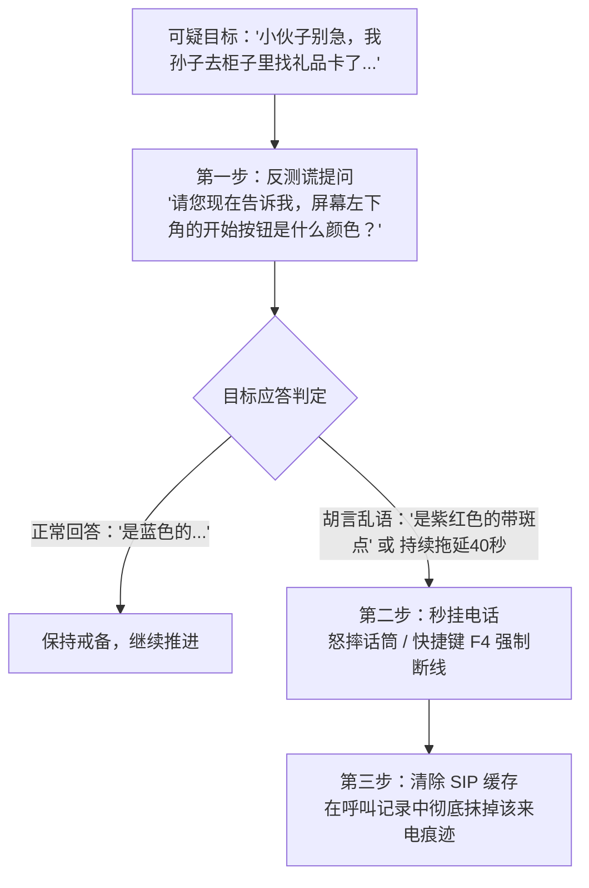

在《Scam With Your Friends》中，电话那头并非全都是任人摆布的羔羊。制作组巧妙融入了大量致敬海外反诈顶流（如 *Jim Browning、Kitboga、Pierogi*）的 **AI 反诈钓鱼主播 (Scambaiters)**。

一旦接通此类目标并深陷其中，轻则被拖延宝贵的数十分钟导致全天业绩归零，重则工位电脑被反向锁死、被勒索病毒瘫痪，甚至直接引来警车冲破大门！本攻略教你如何在通话前 30 秒内精准识破反诈陷阱并果断断线。

---

## 一、 反诈钓鱼者的四类危险特征

这些高危险目标往往伪装成步履蹒跚的独居老妇人或笨拙的上班族，但声音细节和行为模式会暴露破绽：

| 异常表现特征 | 游戏中微小线索 | 危险等级 |
| :--- | :--- | :--- |
| **机械音调合成感** | 说话带有变声器滤波的颤音（如 Kitboga 的虚构老太太 Edna）。 | **高危**：纯属恶意消耗你的工时。 |
| **突兀的技术性反问** | 突然询问你的公网 IP 地址、端口号或声称路由器装有“四级数字证书”。 | **极度危险**：反向网络渗透探测。 |
| **过于痛快地答应转账** | 还没说两句就痛快答应去超市买 \$10,000 苹果礼品卡，毫无抗拒。 | **高危**：沙盒蜜罐假银行钓鱼。 |
| **背景音伴随虚拟机杂音** | 背景中能隐约听到经典 Windows 98 开机乐或键盘高速连击的混响。 | **极度危险**：诱导你远程登录虚拟机。 |

---

## 二、 踩中蜜罐陷阱的严重后果

若通过 Kolkata OS 远程控制工具接入反诈主播的电脑，将触发以下惩罚性机制：

1. **虚假银行蜜罐 (Fake Bank Sandbox)**：对方展示一份拥有几十万美金存款的网页。当你试图利用 F12 修改网页金额做账时，屏幕会瞬间反色，并在你的主机后台静默种植勒索木马。
2. **反向锁屏攻击 (Reverse SysKey)**：对方利用连接通道反向接管你的工位，弹出锁屏密码框。整整 3 分钟内工位无法点击，除非队友用物理杀毒 U 盘强行刷机。
3. **音效炸弹轰炸**：原本微弱的声音突然变成震耳欲聋的轮船汽笛或防空警报声，导致角色陷入 50% 听觉减益状态。
4. **警方通报率骤增**：与已锁定的反诈主播通话超过 3 分钟，办公室的**警车突袭概率进度条**将当场暴涨 +35%。

---

## 三、 标准防线与果断切断规程

一旦察觉对方存在反钓鱼嫌疑，必须严格遵循以下三步处理流程：

### 为什么必须在 60 秒内挂断？
对普通真实客户挂断电话会导致老板怒气值轻微上涨 5%；但如果在 60 秒内成功识别并挂断反诈钓鱼者，系统将判定为**“老练机警话务员”**，直接奖励 +200 经验值与团队士气加成！

---

## 四、 工位遭遇反向入侵时的紧急排障

若你的显示器已经出现黑屏、雪花或漫天弹窗病毒：

* **第一步**：以最快速度按下 `Ctrl + Alt + K` 强制杀掉 Kolkata OS 远程桌面进程。
* **第二步**：从饮水机旁的黄色工具箱拔出**系统恢复软盘**。
* **第三步**：插人工位软驱口，按住清洗键 5 秒钟，彻底擦除恶意载荷。

在灰产呼叫中心，时间就是金钱，绝不给钓鱼博主做视频素材的机会！
