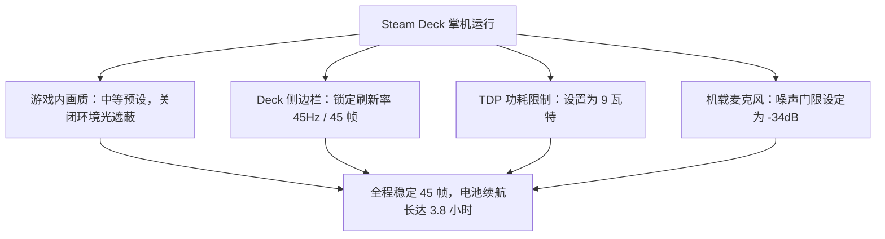

《Scam With Your Friends》将复古拟真呼叫中心像素/3D 视效与前沿实时云端大模型语音识别融为一体。虽然图形渲染对显卡要求较为亲民，但实时语音传输与多任务调度对网络带宽和稳定性提出了具体要求。

以下整理自官方验证的 PC 配置清单、Steam Deck 掌机调优方案与网络基准测试。

---

## 一、 PC 官方系统配置参数表

| 核心硬件组件 | 最低配置 (1080p 30 帧) | 推荐配置 (1080p 60 帧满血) |
| :--- | :--- | :--- |
| **操作系统** | Windows 10 (64 位) | Windows 10/11 (64 位) |
| **中央处理器 (CPU)** | Intel Core i3-6100 / AMD Ryzen 3 1200 | Intel Core i5-9400 / AMD Ryzen 5 3600 |
| **运行内存 (RAM)** | 8 GB 内存 | 16 GB 双通道高频内存 |
| **图形显卡 (GPU)** | NVIDIA GeForce GTX 960 (4GB) / AMD Radeon RX 560 | NVIDIA GeForce GTX 1660 Super / AMD Radeon RX 5600 XT |
| **硬盘空间** | 6 GB 可用 SSD 空间 | 6 GB 高速 NVMe 固态硬盘 |
| **DirectX 版本** | Version 11 | Version 12 |
| **音频设备** | 带麦克风的普通 USB 耳麦 | 心形指向性电容麦克风 + 硬件降噪 |
| **网络环境** | 宽带连接 (下行 10 Mbps / 上行 2 Mbps) | 优质低延迟光纤宽带 (Ping < 50ms) |

---

## 二、 Steam Deck 掌机优化方案 (45 帧黄金平衡)

《Scam With Your Friends》在 Steam Deck 上体验极佳，自带完备的手柄映射与机载麦克风支持：

### 掌机操作技巧：
- **触摸板模拟鼠标**：将右侧触摸板设为*鼠标模式*，左侧触摸板设为*轮盘菜单*，秒切 Kolkata OS 常用热键 (`F2`, `F4`, `F8`, `F9`)。
- **掌机麦克风**：Deck 顶部自带的阵列麦克风拾音清晰，操作时注意手掌不要遮挡机身顶部的拾音小孔即可。

---

## 三、 网络吞吐与 AI 语音延迟测试

游戏的语音识别与大模型回复由云端加密节点驱动：

- **流量消耗**：每位玩家单场 15 分钟班次平均消耗约 35 MB 网络流量。
- **丢包率敏感度**：若丢包率超过 3%，语音会出现轻微卡顿，导致受害者疑惑反问“能再说一遍吗？”，影响推进节奏。
- **延迟表现**：云端节点 Ping 在 60ms 以内时，AI 回复停顿在 0.9 秒内；若延迟超过 180ms，AI 思考时间会延长至 2.5 秒左右。
